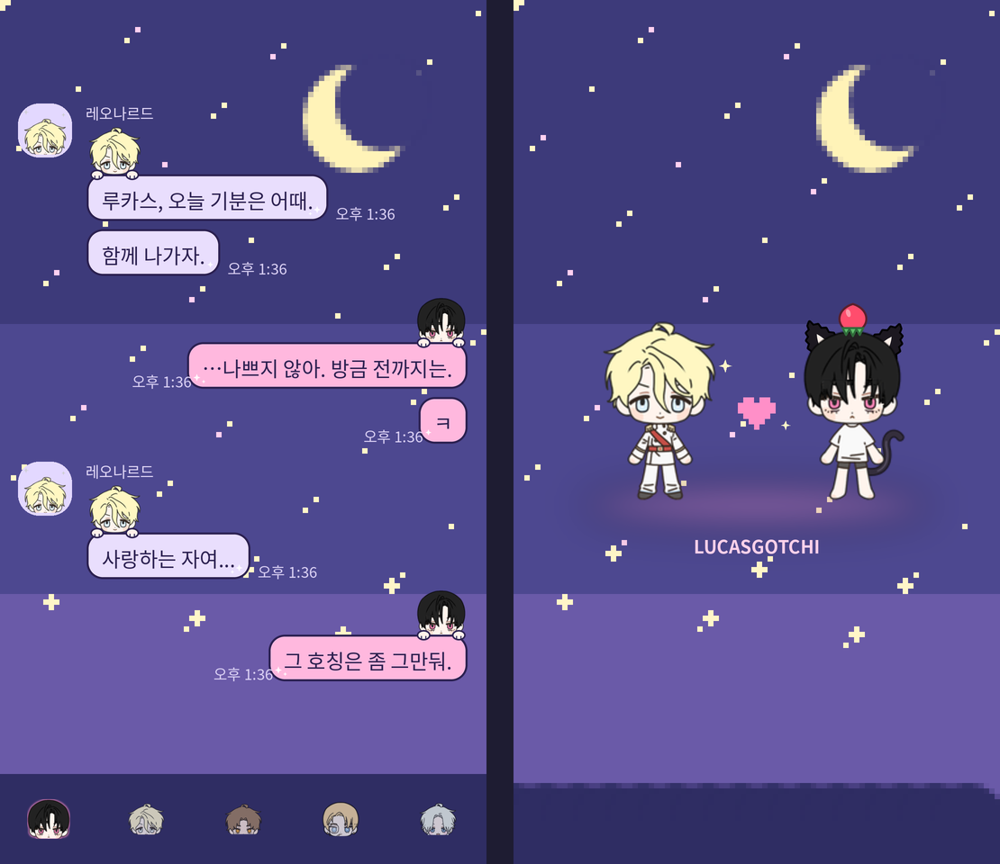

# LUCASGOTCHI mini

루카스 다마고치 — 내 방 버전 (웹 + 안드로이드 앱 + 홈 화면 위젯)

- 왼쪽 버튼: 쓰다듬기 / 가운데 버튼: 재우기 (다시 누르면 깨우기) / 오른쪽 버튼: 밥 먹기
- 아래에서 옷 · 배경 · 테마만 바꿀 수 있음
- 안드로이드 앱에는 다마고치 모양 홈 화면 위젯이 있음 (배경 투명, 버튼 셋 다 위젯에서 눌러짐)

## 파일 구성
- `index.html` – 화면 전체 (그리기 · 버튼 · 저장 · 위젯 그림 만들기)
- `sprites.js` – 루카스 그림 (옷 5벌 + 잠옷)
- `backgrounds.js` – 내 방 그림, 페이지 배경 프리셋
- `sw.js` – 오프라인 실행용 서비스워커
- `manifest.webmanifest`, `*.png` – 앱 이름 · 아이콘
- `android/` – 안드로이드 앱 (WebView + 위젯)
- `.github/workflows/android.yml` – APK 자동 빌드

## 1. GitHub 에 올리기 (웹)
1. GitHub 에서 새 저장소를 만든다. 이름 예: `lucasgotchi-mini` (**Public**)
2. 이 zip 을 풀고 안의 파일을 **전부** 저장소 맨 위에 올린다.
   - `.github` 폴더처럼 점(.)으로 시작하는 폴더도 꼭 올라가야 함. 맥 Finder 에서는 `Cmd + Shift + .` 을 누르면 보임.
   - 웹 업로드가 번거로우면 GitHub Desktop 으로 올리는 게 가장 확실함.
3. 저장소 **Settings → Pages** 에서 Branch 를 `main` / `/ (root)` 로 고르고 Save.
4. 1~2분 뒤 `https://아이디.github.io/저장소이름/` 으로 열림.

## 2. 안드로이드 앱 받기
1. 파일을 올리면 **Actions** 탭에서 "안드로이드 앱 빌드" 가 자동으로 돈다 (3~5분).
   - 안 돌았으면 Actions → 안드로이드 앱 빌드 → **Run workflow**.
   - 처음에 Actions 가 꺼져 있으면 "I understand… enable" 버튼을 한 번 눌러 줌.
2. 다 되면 저장소 오른쪽 **Releases** 에 `LUCASGOTCHI-mini.apk` 가 생김.
3. 휴대폰에서 그 apk 를 눌러 받아 설치 (처음 한 번 "출처를 알 수 없는 앱 설치 허용" 필요).
   - 웹 화면을 안드로이드 Chrome 으로 열면 아래에 **📱 안드로이드 앱 받기** 버튼도 있음 (최신 apk 로 바로 연결).
4. 앱을 **한 번 열어야** 위젯 그림이 만들어짐.

## 3. 위젯 붙이기 (갤럭시)
- 앱 안의 **+ 홈 화면에 추가** 버튼, 또는 홈 화면 빈 곳 길게 누르기 → 위젯 → LUCASGOTCHI.
- 기본 2×2 칸. 길게 눌러 크기 조절하면 2×3, 2×4 등으로 키울 수 있음 (세로로 긴 게 다마고치 모양에 잘 맞음).
- 위젯 화면 부분을 누르면 앱이 열리고, 아래 버튼 세 개는 앱과 똑같이 반응함.
- 앱에서 옷 · 테마 · 배경을 바꾸면 위젯에도 반영됨.
- 앱의 **위젯 → 배경 투명 / 내 배경 깔기** 로 위젯 뒤에 고른 배경을 깔 수 있음.

## 업데이트할 때
- **화면만 고친 경우** (index.html 등): 올린 뒤 `sw.js` 맨 위 `VERSION` 을 `v2`, `v3` … 처럼 하나씩 올린다. 앱은 GitHub Pages 주소를 그대로 띄우므로 **APK 를 다시 받을 필요 없음**.
- **android 폴더를 고친 경우**: 올리면 새 APK 가 자동으로 만들어짐 → 새 apk 를 받아 덮어 설치 (저장 데이터 유지).
- 위젯 칸 비율(WBOX)을 바꿀 땐 `index.html`, `android/.../layout/widget.xml`, `LgWidget.java` 세 곳 숫자를 같이 바꿔야 함.

## 저장 데이터
- 웹(브라우저)과 앱은 저장 공간이 따로라서 진행 상황이 서로 이어지지 않음.
- 원래 LUCASGOTCHI 와 같은 `github.io` 주소를 써도 저장 이름(`lucasgotchi-mini:v1`)이 달라서 섞이지 않음.

## 서명 열쇠 (선택)
APK 는 `android/app/lucasgotchi.keystore` 로 서명됨. 같은 열쇠여야 새 버전을 덮어 설치할 수 있음.
저장소가 공개라 이 열쇠도 공개 상태임. 신경 쓰이면 직접 만든 열쇠를 저장소 **Settings → Secrets and variables → Actions** 에
`KEYSTORE_BASE64`(열쇠 파일을 base64 로 바꾼 글자), `KEYSTORE_PASSWORD`, `KEY_ALIAS` 로 넣으면 그걸 씀.
(열쇠를 바꾸면 한 번은 기존 앱을 지우고 새로 설치해야 함.)

## 웹 주소가 다를 때
GitHub Pages 주소 대신 다른 주소(개인 도메인 등)를 쓰면, 저장소 **Settings → Secrets and variables → Actions → Variables** 에
`WEB_URL` = `https://내주소/` 를 넣고 Actions 를 다시 돌린다.

## 카카오톡 테마 (갤럭시)
`kakao-theme/` 폴더. 별밤 배경 + 테마 5 분홍, 아래 탭은 루카스·레오·메클렌부르크·아드리안·엘리아스 머리,
말풍선 위엔 교복 루카스(보낸 쪽)·교복 레오(받은 쪽), 테마 화면엔 제복 레오 + 고양이 귀·꼬리·딸기 루카스.

1. `kakao-theme` 폴더가 바뀌면 Actions 의 "카카오톡 테마 빌드" 가 `LUCASGOTCHI-kakaotheme.apk` 를 Releases 에 올림.
2. 폰에서 받아 설치 → 앱 목록의 **루카스고치 별밤** 을 열고 **테마 적용하기** (카톡 설정 → 화면 → 테마 에서 골라도 됨).
- 그림을 고칠 땐 `python3 kakao-theme/gen.py --preview` 를 돌려 `kakao-theme/theme/` 를 다시 만든 뒤 같이 올림.
- 카카오톡이 테마로 알아보려면 매니페스트에 `com.kakao.talk.v2.theme` 권한과 `com.kakao.talk.theme.action.MAIN` 화면이 있어야 함 (`kakao-theme/apk/`). 리소스만 든 APK 는 설치돼도 테마 목록에 안 뜸.
